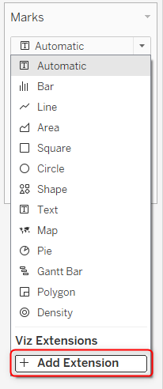
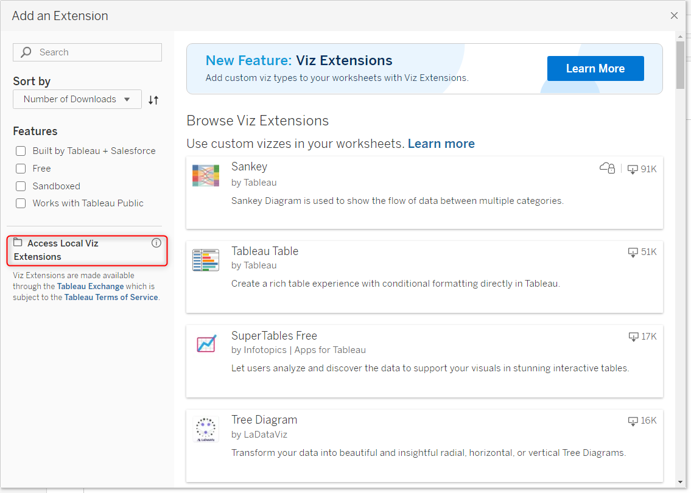

# Viz Extension Documentation

## General Information

### First Steps

Create a new sheet. Add an extension by selecting "add extension" in the dropdown-menu of the Marks card.

Select "Access Local Viz Extensions".

Select the .trex file corresponding to the extension to use.  
Allow the extension.  
A tutorial is displayed in the extension until data is added to the Marks card.

Viz extensions require Tableau 2024.2 or later.

### Customization window

Click the format extension button in the Marks card to open the customization window.

- Changes are previewed live in the extension while you edit the settings.
- Colors can be typed (HTML names, hexadecimal, rgb) or chosen with a color picker.
- Click the help button to display the tutorial in the window.
- If you close the window with unsaved changes, a warning asks whether to save them or close without saving.

### Actions

The viz extensions use the actions of Tableau. To filter other sheets on a dashboard, select the sheet of the extensions in the Action tab.
